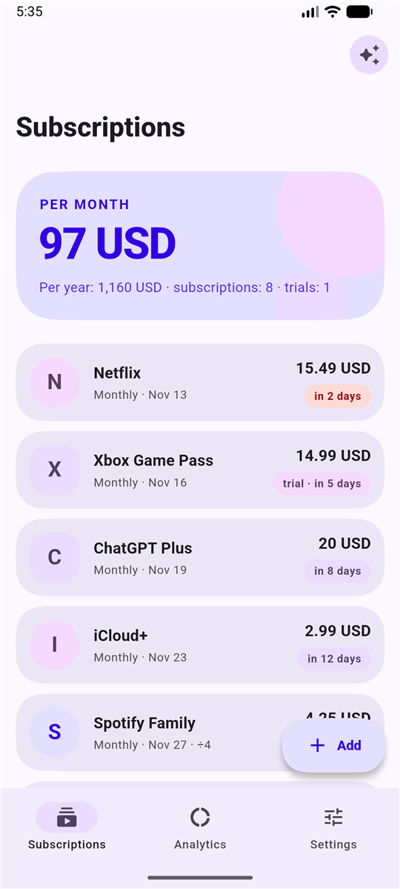
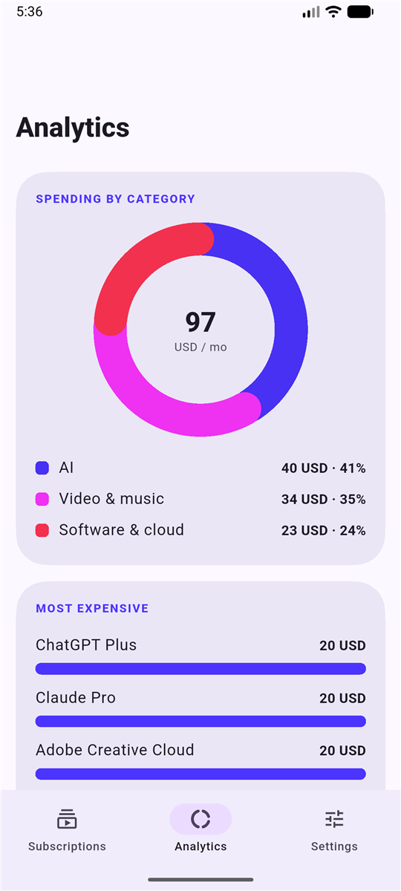
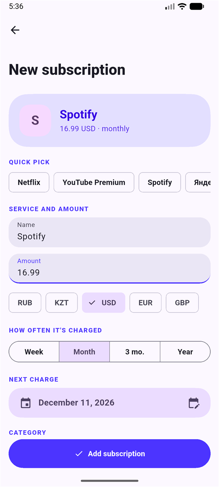
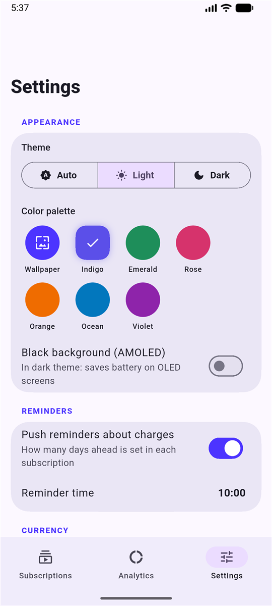
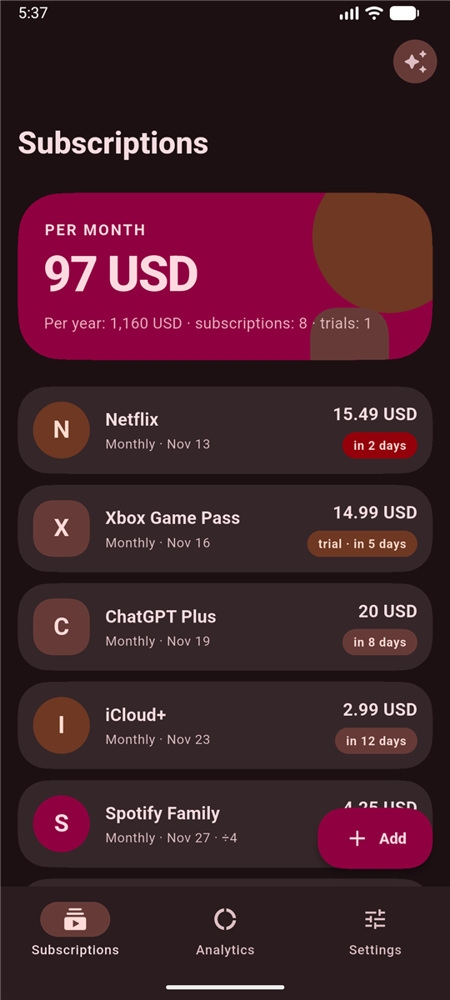
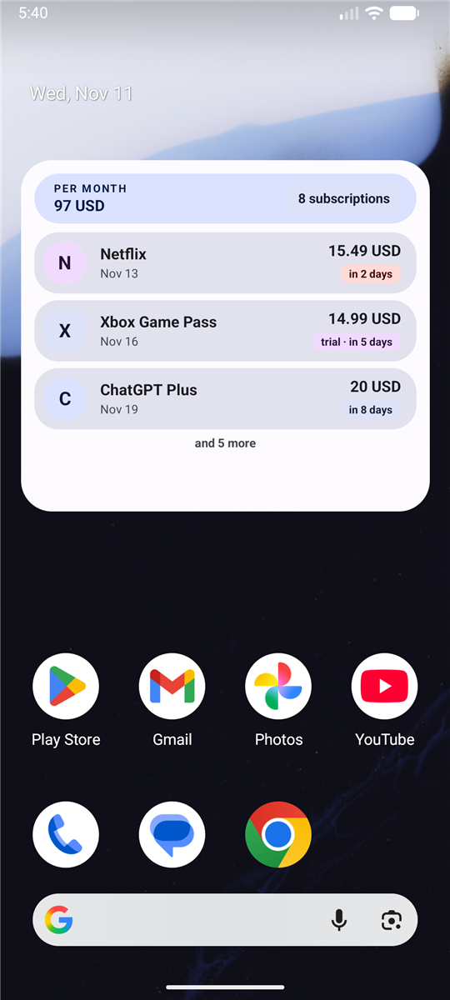
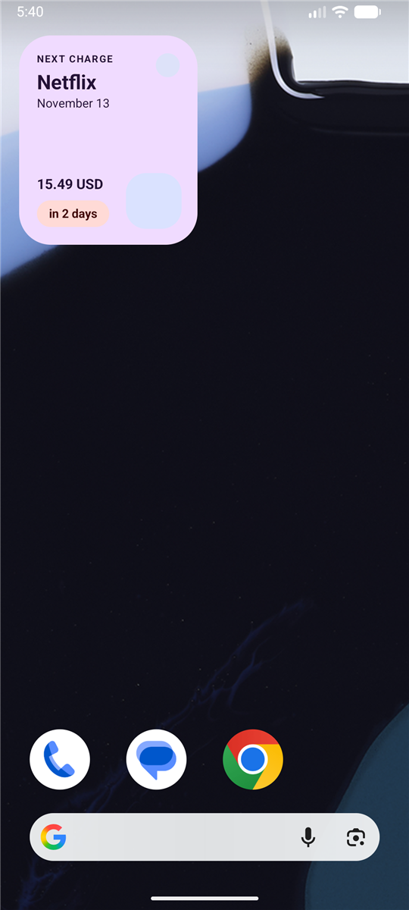

<h1 align="center">Recur</h1>

<p align="center">
  A subscription tracker for Android with reminders, analytics, home screen widgets and a Material 3 look.
</p>

<p align="center">
  
  
  
  
  
  
  <a href="https://www.donationalerts.com/r/hashonq1"></a>
</p>

<p align="center">
  <b>English</b> · <a href="README.ru.md">Русский</a>
</p>

---

Recur keeps all your subscriptions in one place so a charge never catches you by surprise. Everything is stored on your device: no account, no server, no ads, no analytics.

> **Status: working beta.** The core app is built and tested on an emulator, but it has not been through a real-world round of testing yet. See [Project status](#project-status) for what is verified and what is not.

## Download

The ready-to-install APK is in [Releases](https://github.com/hexx772/recur/releases/latest): **Recur-1.0.0.apk** (about 58 MB, Android 7.0 or newer).

1. Download the APK on your phone and open it. Android will ask you to allow installs from that source.
2. Optional: check the file. SHA-256: `4f78fedec58e51d11f9a510aa7c10d99e505bbc52891deb6a5a6dd41372c2bbf`

The APK is signed with the standard Android **debug key**, not a store key. That is fine for trying the app, but it is not a Google Play build. A future build signed with another key can only be installed after uninstalling this one, so export a backup first. Gmail sign-in does not work in this build until you set up your own Google OAuth client.

## Screenshots

<p align="center">
  
  
  
  
  
</p>
<p align="center">
  
  
</p>
<p align="center"><sub>Subscriptions, analytics, the add form, settings, the dark theme with the Rose palette, and two of the three widgets. Taken on an emulator with demo data.</sub></p>

## Features

**Tracking**
- Add subscriptions by hand: name, price, currency, billing period (weekly, monthly, every 3 months, yearly), next charge date, category.
- A quick-pick list of popular services (video and music, AI, software and cloud, games) fills in the name and category for you.
- The charge date rolls forward on its own after it passes. Month ends are handled (31 Jan becomes 28 Feb).
- Categories include **AI** (ChatGPT, Claude, Gemini, Perplexity, Midjourney, GitHub Copilot, Cursor). You can add your own categories.
- Search by name or category, filter by category, and sort by charge date, price or name.
- An end date for subscriptions paid up to a certain day: no charges after it, plus an "ends soon" reminder.
- A price history per subscription. A price rise is recorded and shows up in analytics as extra spending per year.
- Optional names of the people you share a plan with.

**Money**
- Monthly and yearly totals, kept separate per currency.
- Currency conversion into one main currency at current exchange rates: per subscription, or for all subscriptions at once in settings.
- **Shared plans:** split a family or group subscription; only your share is counted.
- **Free trials:** a trial is not counted in totals, and you get a reminder to cancel before the first payment.
- **Spending limit:** set a monthly budget and watch a progress bar on the main screen.

**Reminders**
- Push notifications a chosen number of days before each charge, at a chosen time. The next three charges of every subscription are scheduled and restored after a reboot.
- Each reminder has two buttons: **How to cancel** (opens the cancellation page) and **Snooze** (repeats in a day).
- The notification permission is requested on first launch.

**Analytics**
- Spending by category (animated donut chart) and the five most expensive subscriptions.
- Trial overview and the saving from shared plans.
- A 12-month forecast that puts yearly charges into the right month.

**Calendar**
- A month view with dots on charge days, the month total, and the list of charges for the selected day.

**How to cancel**
- A one-tap link to the cancellation page of popular services, or a web search for the rest. You can set your own link per subscription.

**Home screen widgets (Android)**
- **List:** all subscriptions, fitted to the size you give the widget (no scrolling). What does not fit collapses into an "and N more" line.
- **Next:** the next charge at a glance.
- **Total:** monthly and yearly spending.
- Colors follow your wallpaper (Material You), light and dark.

**Backup**
- Export subscriptions **and settings** (currency, reminders, theme) to a JSON file and restore them after reinstalling. Export to CSV for spreadsheets and import it back.
- Subscriptions and settings are also part of Android's automatic backup, so they can follow you to a new phone.

**Security**
- Optional app lock with a fingerprint, face or your phone PIN.

**Languages**
- Russian and English, chosen from the system language. Ukrainian, Belarusian and Kazakh systems get Russian. On Android 13 and newer the app language can also be set separately in system settings.

### Beta features

- **Find subscriptions in Gmail.** Reads receipts and charge notices (read-only access), analyses them on the device and offers candidates. You confirm each one. Needs your own Google OAuth client, see [Gmail setup](#gmail-setup).
- **Find subscriptions in bank SMS (Android).** Reads SMS from the last 180 days and looks for charges from a built-in list of known services. The billing period is guessed from the gap between charges.

Nothing is added without your confirmation, and no message leaves the device.

## Design

Recur follows Material 3 and borrows its Expressive ideas, which Flutter does not ship as ready-made components yet, so they are built here:

- **Dynamic color** from your wallpaper (Android 12+), or one of six palettes, with a light, dark and black AMOLED theme.
- **Shapes:** superellipse cards with generous radii, avatars that alternate between circle and rounded square, large collapsing app bars.
- **Typography:** bold, large numbers for money, small spaced capitals for section labels.
- **Motion:** spring press feedback on cards, staggered list entrance, count-up totals, an animated donut, and a shared-axis transition between tabs.
- **Adaptive icon** with a themed (monochrome) layer.

## Project status

This is an honest snapshot of the current state.

**Works and is checked** (on an Android emulator, API 37)
- The release APK installs and runs. The subscriptions, analytics, add-subscription and settings screens, the light and dark themes with several palettes, and the English interface were checked by eye. The screenshots above come from this build.
- Restoring a backup from a file works, together with the settings stored in it.
- The notification permission is requested on first launch.
- The **List** widget fits its rows to the size it is given and collapses the rest into an "and N more" line. The **Next** widget loads and shows the next charge. The **Total** widget's preview loads, but it was not placed on the home screen.
- Calendar, the 12-month forecast, the price-rise card, search and sort, and the spending limit bar were checked on the emulator in the signed release build.
- Static analysis is clean and 33 unit tests pass: parsing of emails and SMS, dates and end dates, forecast, CSV import, shares and trials, cancellation links, backup with settings, palettes, English translations.

**Not verified yet**
- Anything on a real phone. The emulator was the only device used, and launchers differ in how they report widget size.
- The app lock (biometrics), the notification action buttons, and CSV import through the file picker.
- Notification delivery and timing (scheduling is inexact, so delivery can be a few minutes late).
- Backup export through the share sheet (only restore was exercised).
- The English translation has not been reviewed by a native speaker. A few brand names in the quick-pick list (for example Yandex Plus) stay in Russian.
- Gmail sign-in, and parsing of real bank SMS, which differ a lot between banks. Only a built-in list of services is recognised.

**Known limits**
- **Android only.** The iOS project exists but is not set up: no widgets, no SMS, no app icon.
- The release build is signed with the debug key. A real release key is needed before publishing.
- Gmail sign-in needs your own Google Cloud OAuth client. Google also requires app verification for the `gmail.readonly` scope before other people can use it.
- `READ_SMS` is a restricted permission on Google Play. A Play build should leave SMS out.
- The free exchange-rate service (`open.er-api.com`) asks for attribution; a credit line is not in the app yet.
- Data is kept in local preferences without extra encryption. There is no cloud sync between devices.
- Automatic sync with services is **not possible directly**: most services have no public API for subscriptions. Gmail and SMS parsing are workarounds.

**Ideas**
- Bank sync through an open-banking aggregator (depends on the region).
- Release signing, a Play build flavor without SMS, screenshots, CI.
- iOS support and widgets.

## Getting started

You need [Flutter](https://docs.flutter.dev/get-started/install) (3.47 or newer) and the Android SDK.

```bash
flutter pub get
flutter test
flutter run
```

Build an APK:

```bash
flutter build apk --release
```

**Signing.** Put your key details into `android/key.properties` (`storePassword`, `keyPassword`, `keyAlias`, `storeFile`). Git ignores that file. Without it a release build is signed with the debug key, so the project still builds for anyone.

**Flavors.** `full` is the default: it includes the bank SMS search and the `READ_SMS` permission. `play` is for Google Play and has no SMS permission:

```bash
flutter build appbundle --flavor play --dart-define=SMS=false
```

### Gmail setup

1. In the [Google Cloud Console](https://console.cloud.google.com/) create a project and enable the **Gmail API**.
2. Configure the OAuth consent screen, add the scope `https://www.googleapis.com/auth/gmail.readonly` and your account as a test user.
3. Create an OAuth client for Android with the package name `com.appsub.appsub` and the SHA-1 of your signing key.

Without it the Gmail button shows a sign-in error. The rest of the app works.

## Project structure

```
lib/
  main.dart              app start, theme, locale
  data/                  settings, subscription store, known services
  models/                the Subscription model and billing periods
  services/              Gmail, SMS, exchange rates, notifications, backup, widget sync
  screens/               home, edit, analytics, settings, beta screens
  theme/                 Material 3 theme, palettes
  widgets/               spring press and entrance animations
  l10n/                  Russian-to-English dictionary
android/app/src/main/    widget providers (Kotlin), layouts, icons, strings
test/                    unit tests
store/                   privacy policy and Google Play listing texts
```

Built with Flutter, `shared_preferences`, `dynamic_color`, `home_widget`, `flutter_local_notifications`, `google_sign_in`, `animations`, `share_plus`, `file_picker`.

## Privacy

Subscriptions and settings stay on the device. The only network request that does not go to Google is the download of public exchange rates, and it carries no personal data. The full text is in [store/privacy-policy.md](store/privacy-policy.md).

## Support

Recur is free and open source. If you find it useful and want to say thanks, you can optionally send a donation: **[donationalerts.com/r/hashonq1](https://www.donationalerts.com/r/hashonq1)**. Donations are voluntary and do not unlock anything.

## License

[MIT](LICENSE)

Service names used as examples (Netflix, Spotify and others) are trademarks of their owners. Recur is not affiliated with them.
