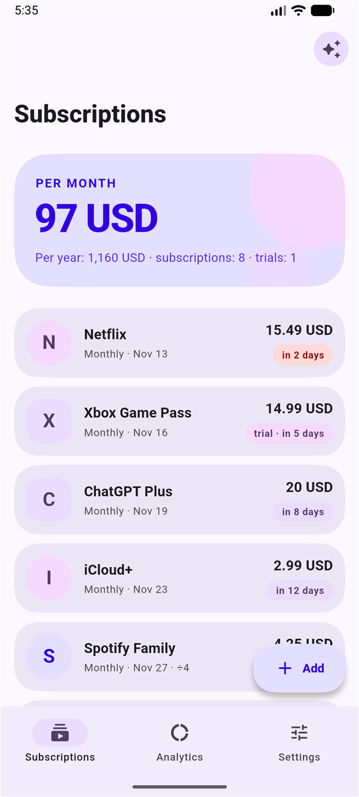
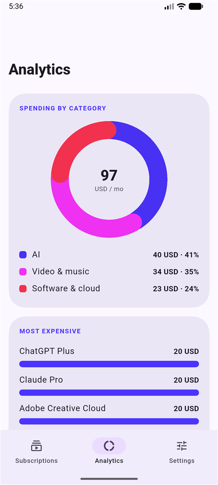
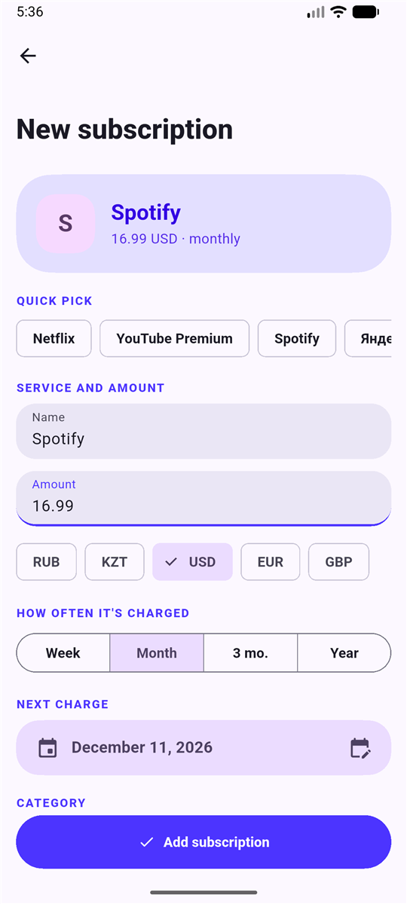
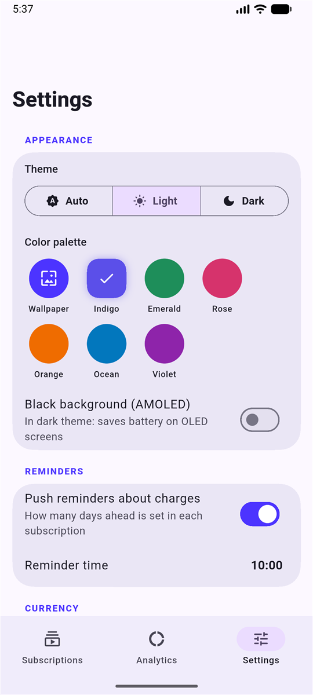
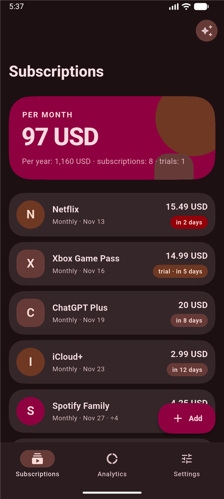
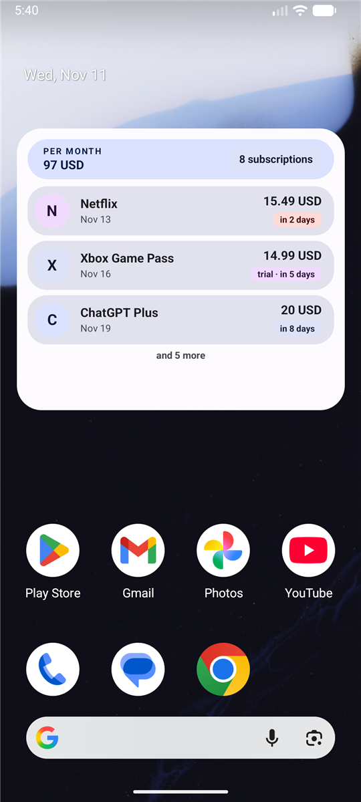
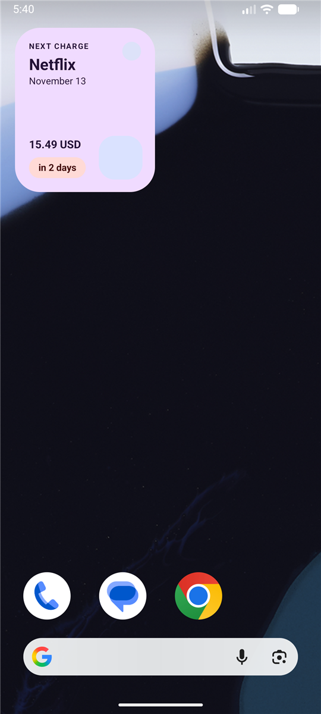

<h1 align="center">Recur</h1>

<p align="center">
  Учёт подписок для Android: напоминания, аналитика, виджеты на рабочий стол и дизайн Material 3.
</p>

<p align="center">
  
  
  
  
  
  
  <a href="https://www.donationalerts.com/r/hashonq1"></a>
</p>

<p align="center">
  <a href="README.md">English</a> · <b>Русский</b>
</p>

---

Recur собирает все ваши подписки в одном месте, чтобы списания не заставали врасплох. Всё хранится на вашем устройстве: без аккаунта, без сервера, без рекламы и аналитики.

> **Статус: рабочая бета.** Основное приложение собрано и проверено на эмуляторе, но ещё не прошло проверку в реальной жизни. Что проверено, а что нет, описано в разделе [Состояние проекта](#состояние-проекта).

## Скачать

Готовый APK лежит в разделе [Releases](https://github.com/hexx772/recur/releases/latest): **Recur-1.0.0.apk** (около 58 МБ, Android 7.0 и новее).

1. Скачайте APK на телефон и откройте его. Android попросит разрешить установку из этого источника.
2. По желанию проверьте файл. SHA-256: `4f78fedec58e51d11f9a510aa7c10d99e505bbc52891deb6a5a6dd41372c2bbf`

APK подписан стандартным **отладочным ключом** Android, а не ключом магазина. Для знакомства с приложением это нормально, но это не сборка для Google Play. Будущую сборку с другой подписью можно будет поставить только после удаления этой, поэтому заранее сделайте резервную копию. Вход через Gmail в этой сборке не работает, пока вы не настроите собственный OAuth-клиент Google.

## Скриншоты

<p align="center">
  
  
  
  
  
</p>
<p align="center">
  
  
</p>
<p align="center"><sub>Подписки, аналитика, форма добавления, настройки, тёмная тема с палитрой Rose и два из трёх виджетов. Сняты на эмуляторе с демонстрационными данными, интерфейс на английском.</sub></p>

## Возможности

**Учёт**
- Ручное добавление подписок: название, цена, валюта, периодичность (неделя, месяц, 3 месяца, год), дата следующего списания, категория.
- Список популярных сервисов для быстрого выбора (видео и музыка, AI, софт и облако, игры) подставляет название и категорию.
- Дата списания сама переносится вперёд. Концы месяцев учтены (31 января превращается в 28 февраля).
- В категориях есть **AI** (ChatGPT, Claude, Gemini, Perplexity, Midjourney, GitHub Copilot, Cursor).

**Деньги**
- Итоги за месяц и за год отдельно по каждой валюте.
- Пересчёт в одну основную валюту по текущему курсу: для отдельной подписки или сразу для всех в настройках.
- **Общая оплата:** разделите семейную или групповую подписку, считается только ваша доля.
- **Пробные периоды:** триал не входит в итоги, а перед первым платежом приходит напоминание отменить.

**Напоминания**
- Push-уведомления за выбранное число дней до списания, в выбранное время. Планируются три ближайших списания каждой подписки, после перезагрузки телефона они восстанавливаются.
- Разрешение на уведомления запрашивается при первом запуске.

**Аналитика**
- Расходы по категориям (анимированная кольцевая диаграмма) и пять самых дорогих подписок.
- Обзор триалов и экономия на общей оплате.

**Как отменить**
- Ссылка на страницу отмены популярных сервисов в одно касание, для остальных поиск в интернете. Для каждой подписки можно задать свою ссылку.

**Виджеты на рабочий стол (Android)**
- **Список:** все подписки, подстроенные под размер, который вы задали виджету (без прокрутки). То, что не поместилось, сворачивается в строку «и ещё N».
- **Ближайшее:** ближайшее списание крупно.
- **Итог:** расходы за месяц и за год.
- Цвета берутся из обоев (Material You), светлая и тёмная темы.

**Резервная копия**
- Экспорт подписок **и настроек** (валюта, напоминания, тема) в JSON и восстановление после переустановки. Экспорт в CSV для таблиц.

**Языки**
- Русский и английский, выбираются по языку системы. Системы с украинским, белорусским и казахским языками получают русский.

### Бета-функции

- **Поиск подписок в Gmail.** Читает чеки и уведомления о списании (доступ только на чтение), разбирает их на устройстве и предлагает кандидатов. Каждого вы подтверждаете сами. Нужен собственный OAuth-клиент Google, см. [Настройка Gmail](#настройка-gmail).
- **Поиск подписок в SMS банка (Android).** Читает SMS за последние 180 дней и ищет списания за сервисы из встроенного списка. Периодичность угадывается по интервалу между списаниями.

Без вашего подтверждения ничего не добавляется, и ни одно сообщение не покидает устройство.

## Дизайн

Recur следует Material 3 и берёт идеи Expressive. Во Flutter готовых компонентов для них пока нет, поэтому они сделаны здесь вручную:

- **Динамические цвета** из обоев (Android 12+) или одна из шести палитр, светлая, тёмная и чёрная AMOLED-темы.
- **Формы:** карточки-«суперэллипсы» с большими радиусами, аватарки, чередующие круг и скруглённый квадрат, большие сворачиваемые заголовки.
- **Типографика:** крупные жирные числа для денег, мелкие разрядные заглавные для названий разделов.
- **Движение:** пружинная реакция на нажатие, поэтапное появление списка, «набегающие» суммы, анимированная диаграмма и сдвиг по оси при переходе между вкладками.
- **Адаптивная иконка** с монохромным слоем для тематических иконок.

## Состояние проекта

Честный снимок текущего состояния.

**Работает и проверено** (на эмуляторе Android, API 37)
- Release-APK устанавливается и запускается. Экраны подписок, аналитики, добавления и настроек, светлая и тёмная темы с несколькими палитрами и английский интерфейс проверены глазами. Скриншоты выше сняты с этой сборки.
- Восстановление копии из файла работает вместе с сохранёнными в ней настройками.
- Разрешение на уведомления запрашивается при первом запуске.
- Виджет **«Список»** подстраивает число строк под заданный размер, остальное сворачивает в строку «и ещё N». Виджет **«Ближайшее»** загружается и показывает ближайшее списание. У виджета **«Итог»** загружается превью, но на рабочий стол его не ставили.
- Статический анализ чист, проходят 19 модульных тестов: разбор писем и SMS, доли и триалы, ссылки отмены, копия вместе с настройками, палитры, английские переводы.

**Ещё не проверено**
- Всё на реальном телефоне. Использовался только эмулятор, а лаунчеры по-разному сообщают размер виджета.
- Доставка и точность времени уведомлений (планирование неточное, возможна задержка на несколько минут).
- Экспорт копии через окно «Поделиться» (проверялось только восстановление).
- Английский перевод не вычитан носителем языка. Несколько названий сервисов в списке быстрого выбора (например, Яндекс Плюс) остаются на русском.
- Вход через Gmail и разбор реальных SMS банков, которые сильно различаются. Распознаются только сервисы из встроенного списка.

**Известные ограничения**
- **Только Android.** Проект iOS есть, но не настроен: нет виджетов, SMS и иконки приложения.
- Release-сборка подписана отладочным ключом. Перед публикацией нужен настоящий ключ.
- Для входа через Gmail нужен собственный OAuth-клиент в Google Cloud. Чтобы доступом `gmail.readonly` могли пользоваться другие люди, Google требует проверку приложения.
- `READ_SMS` в Google Play относится к ограниченным разрешениям. Сборка для Play должна обойтись без SMS.
- Бесплатный сервис курсов (`open.er-api.com`) просит указывать источник; строки с указанием в приложении пока нет.
- Данные лежат в локальных настройках без дополнительного шифрования. Синхронизации между устройствами нет.
- Автосинхронизация с сервисами **напрямую невозможна**: у большинства сервисов нет публичного API подписок. Разбор Gmail и SMS ― обходной путь.

**Идеи**
- Синхронизация с банком через агрегатор открытого банкинга (зависит от региона).
- Подпись релиза, вариант сборки для Play без SMS, скриншоты, CI.
- Поддержка iOS и виджетов.

## Запуск

Нужны [Flutter](https://docs.flutter.dev/get-started/install) (3.47 и новее) и Android SDK.

```bash
flutter pub get
flutter test
flutter run
```

Сборка APK:

```bash
flutter build apk --release
```

### Настройка Gmail

1. В [Google Cloud Console](https://console.cloud.google.com/) создайте проект и включите **Gmail API**.
2. Настройте экран согласия OAuth, добавьте область `https://www.googleapis.com/auth/gmail.readonly` и свой аккаунт как тестового пользователя.
3. Создайте OAuth-клиент для Android с именем пакета `com.appsub.appsub` и SHA-1 вашего ключа подписи.

Без этого кнопка Gmail покажет ошибку входа. Остальное приложение работает.

## Структура проекта

```
lib/
  main.dart              запуск приложения, тема, язык
  data/                  настройки, хранилище подписок, справочник сервисов
  models/                модель подписки и периодичность
  services/              Gmail, SMS, курсы валют, уведомления, копии, данные для виджетов
  screens/               главный, форма, аналитика, настройки, бета-экраны
  theme/                 тема Material 3, палитры
  widgets/               пружинное нажатие и анимации появления
  l10n/                  словарь русский → английский
android/app/src/main/    провайдеры виджетов (Kotlin), макеты, иконки, строки
test/                    модульные тесты
store/                   политика конфиденциальности и тексты для Google Play
```

Собрано на Flutter с `shared_preferences`, `dynamic_color`, `home_widget`, `flutter_local_notifications`, `google_sign_in`, `animations`, `share_plus`, `file_picker`.

## Конфиденциальность

Подписки и настройки остаются на устройстве. Единственный сетевой запрос не к Google ― загрузка общедоступных курсов валют, в нём нет персональных данных. Полный текст в [store/privacy-policy.md](store/privacy-policy.md).

## Поддержать

Recur бесплатный и с открытым кодом. Если приложение вам пригодилось и хочется сказать спасибо, можно по желанию отправить донат: **[donationalerts.com/r/hashonq1](https://www.donationalerts.com/r/hashonq1)**. Донаты добровольные и ничего не открывают.

## Лицензия

[MIT](LICENSE)

Названия сервисов в примерах (Netflix, Spotify и другие) принадлежат их владельцам. Recur не связан с ними.
